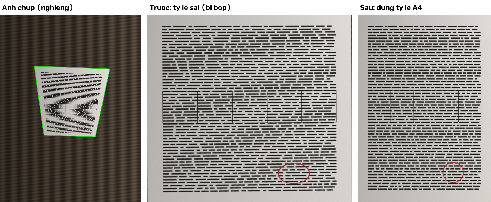
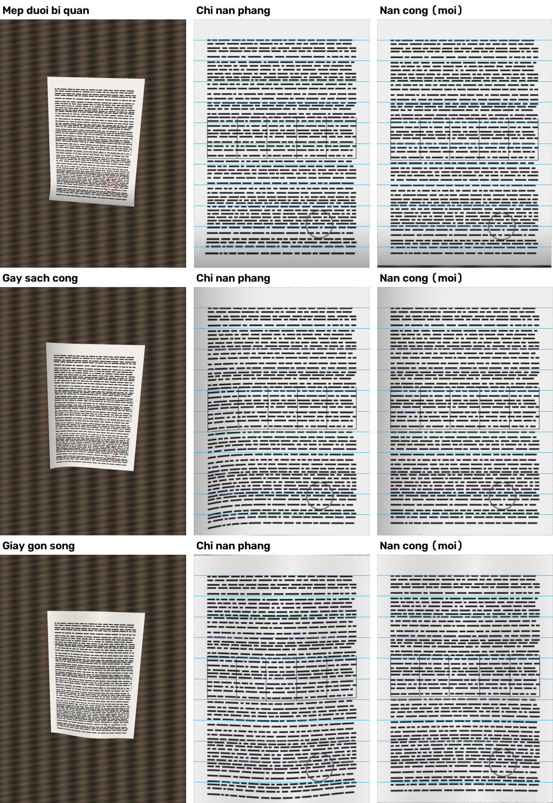
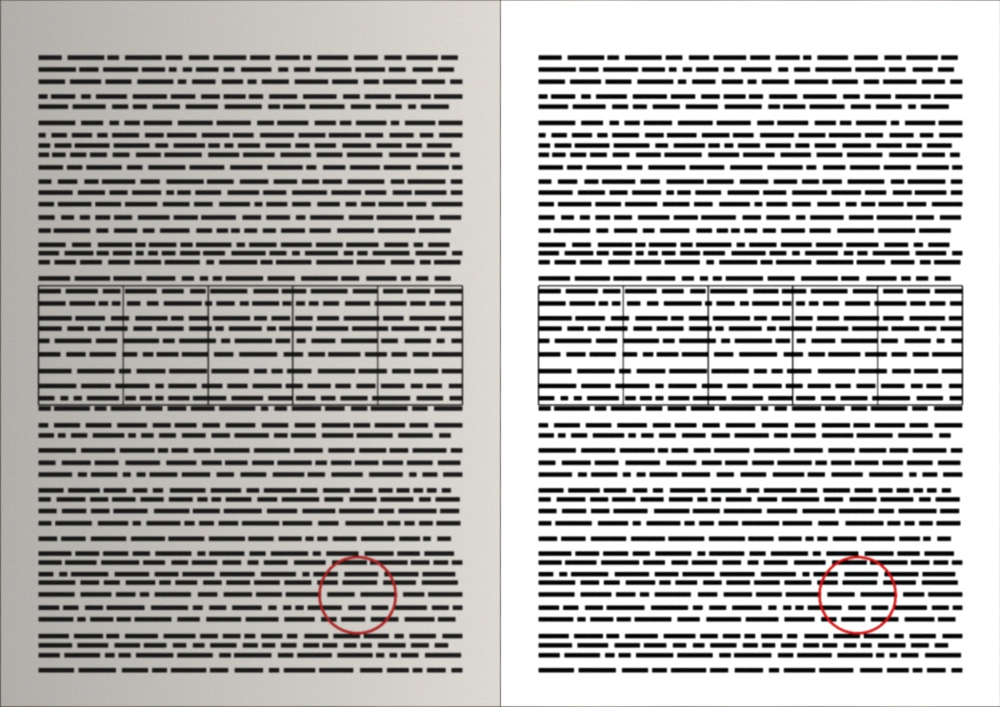

# Kiểm chứng hình học: chụp → nắn phẳng "như máy scan"

Ngày: 2026-11-23 · Công cụ: `tools/sim/` (Python + OpenCV, chỉ dùng để kiểm chứng; app KHÔNG dùng OpenCV).

## Phương pháp
`tools/sim/sim.py` tạo ảnh "chụp bằng điện thoại" theo mô hình camera thật: ảnh 3000×4000, tiêu cự 3100 px, tờ A4 đặt nghiêng 3D theo 7 tư thế (tới 40°, có xoay), nền bàn gỗ có vân, ánh sáng không đều, nhoè quang học và nhiễu. Sau đó chạy đúng chuỗi xử lý của app (bản port từ Dart) và so với đáp án hình học.

## Kết quả

| Tư thế (nghiêng X, Y, xoay) | Góc: thô → tinh chỉnh | Tỷ lệ – cách cũ | Tỷ lệ – cách mới | Khổ khớp |
|---|---|---|---|---|
| 0°, 0°, 3° | 15,9 → 0,74 px | −0,0% | −0,0% | A4 |
| 20°, 0°, 0° | 10,5 → 0,63 px | **+18,8%** | +0,8% → khớp A4 | A4 |
| 30°, 8°, −6° | 11,7 → 0,66 px | **+28,1%** | 0,0% | A4 |
| 35°, −12°, 10° | 10,8 → 0,52 px | **+30,2%** | 0,0% | A4 |
| −25°, 15°, 4° | 8,8 → 0,99 px | **+13,3%** | 0,0% | A4 |
| 10°, 25°, −15° | 8,8 → 0,78 px | **−11,8%** | 0,0% | A4 |
| 40°, 0°, 2° | 14,7 → 0,55 px | **+53,1%** | +3,0% → khớp A4 | A4 |

Có tiêu cự EXIF chính xác: sai lệch tỷ lệ còn ≤ 0,01% ở mọi tư thế.

Con dấu tròn ở góc dưới là phép thử dễ nhìn nhất. Cách cũ làm nó thành hình bầu dục vì trang bị bóp dọc. Cách mới giữ nó tròn.

## Lỗi đã phát hiện và sửa
1. **Sai tỷ lệ khi chụp nghiêng (nghiêm trọng).** Bản v0.1 lấy kích thước đầu ra bằng cạnh dài nhất trên ảnh nghiêng, nên phần giấy ở xa bị bóp lại. Kết quả là tài liệu không cân xứng từ trên xuống, sai 12–53%. Bản sửa ước lượng tỷ lệ thật theo Zhang & He (2007), dùng tiêu cự từ EXIF hoặc tự tính từ 2 điểm tụ. Khi chỉ nghiêng 1 trục (bài toán suy biến), app dùng tiêu cự mặc định của camera điện thoại. Sau đó tỷ lệ được khớp vào khổ A4/A5, Letter hoặc Legal nếu lệch ≤ 3%.
2. **Góc lệch 9–16 px ở ảnh đầy đủ** do nhận diện trên ảnh 720 px. Bản sửa dò lại mép giấy ở độ phân giải đầy đủ theo gradient, khớp đường thẳng bền vững rồi lấy giao điểm, nên sai số còn < 1 px và cạnh thẳng tuyệt đối.
3. **Khoá hướng chụp dọc** làm tài liệu chụp ngang bị quay sai chiều. Bản sửa bỏ khoá để EXIF ghi hướng cầm máy thật.
4. **Nội suy song tuyến** làm mềm chữ nhỏ. Khi xuất file, app dùng Catmull-Rom có kẹp giá trị nên không tạo viền giả.
5. **Không có làm thẳng dòng chữ** khi không thấy mép giấy. App thêm ước lượng độ nghiêng bằng projection profile: mô phỏng đo đúng ±0,05° trong khoảng ±15°, có nút "Tự động" và thanh trượt 0,1°.

## Giới hạn còn lại
- Không có EXIF và chỉ nghiêng 1 trục mạnh (≥ 40°): tài liệu không theo khổ chuẩn có thể lệch tỷ lệ khoảng 1–3%. Khi đó có thể chọn khổ giấy bằng tay.
- Giấy cong (sách, giấy gấp) không nắn được bằng phép phối cảnh phẳng.
- Kết quả trên là **mô phỏng**. Vẫn phải kiểm thử trên điện thoại thật theo `TEST_PLAN.md`, nên trạng thái vẫn là NOT VERIFIED.

---

# Lần 2 – Giấy cong, mép quăn, làm sáng, khổ A4 (2026-11-23)

## Nắn giấy cong (`lib/core/dewarp.dart`)
Mô phỏng `tools/sim/curve.py` + `curl3d.py` dựng mặt giấy cong thật (khai triển được, giữ nguyên độ dài cung) rồi chụp qua camera. Sai số đo bằng độ lệch dòng chữ/cột bảng so với bản gốc, đơn vị px trên trang cao 1000 px.

| Trường hợp | Chỉ nắn phẳng (cũ) | Nắn cong (mới) | Phương pháp chọn tự động |
|---|---|---|---|
| Mép dưới quăn lên 18 mm | 16 | **7** | Mô hình trụ 3D |
| Gáy sách cong 20 mm | 17 dọc / 2 ngang | **0 / 0** | Mô hình trụ 3D |
| Giấy gợn sóng | 20 | **5** | Lưới Coons theo 4 mép cong |
| Giấy phẳng | 0 | **0** (không can thiệp) | Homography |

Mô hình 3D dựng lại được độ cao mép quăn 18 mm (thật 18 mm) và 20 mm (thật 20 mm).

## Làm sáng giấy, giữ nguyên nét mực (`enhancer.dart`)
`tools/sim/enhance_check.py` đo trên ảnh chụp có bóng đổ:

| | Nền giấy | Mực | Tương phản |
|---|---|---|---|
| Ảnh chụp | 183 (106–215) | 49 | 135 |
| Sau xử lý | 239, phần lớn = 255 | 40 | **199** |

Ở chế độ "Scan rõ chữ", app dùng phép kéo giãn TUYẾN TÍNH chung cho mọi điểm ảnh sau khi khử bóng. Thứ tự sáng/tối và biên nét chữ không đổi. Không dùng làm nét, không dùng phép hình thái học, không dùng AI. Con dấu đỏ và chữ ký xanh giữ màu.

## Giới hạn còn lại
- Quăn ở 2 mép cùng lúc hoặc giấy nhàu: app dùng lưới Coons, chỉ nắn được theo hình dạng mép giấy.
- Gáy sách: phần chữ sát gáy bị nén ngang chỉ được bù trong phạm vi mô hình trụ suy ra từ mép trên và mép dưới.
- Mép quăn có thể để lại một dải nền rất mảnh ở mép trang, khoảng 0,5%.
- Tất cả vẫn là mô phỏng: trạng thái NOT VERIFIED cho đến khi thử trên điện thoại thật.
